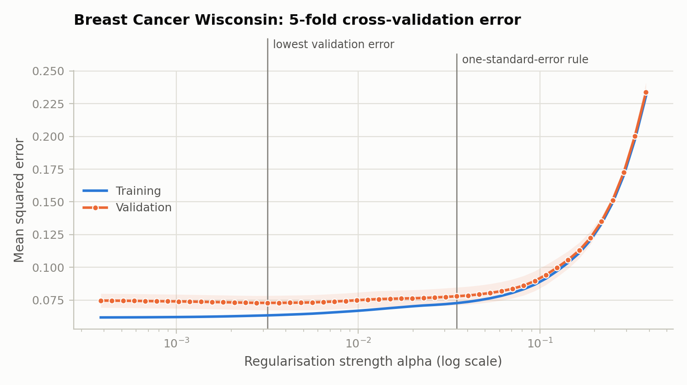
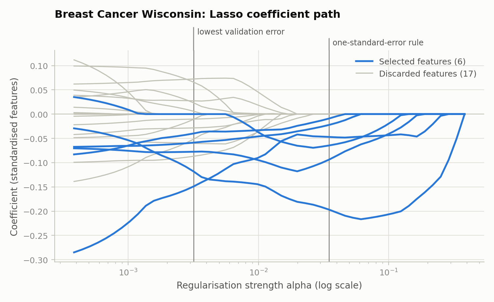
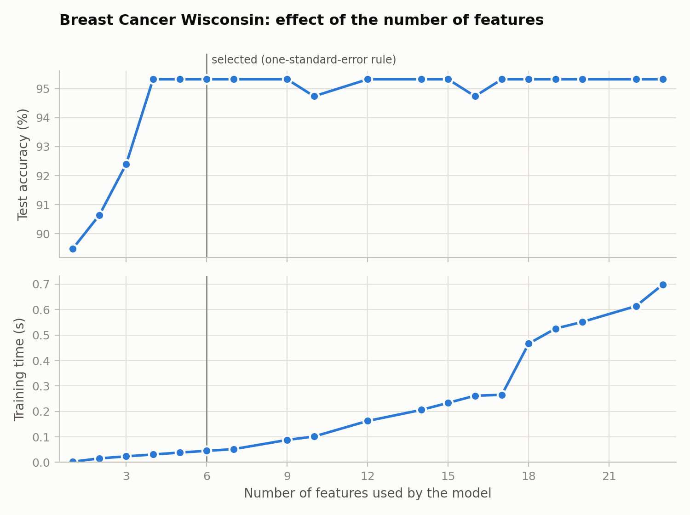

# Lasso Feature Selection from Scratch

Lasso regression implemented from scratch in NumPy (cyclic coordinate descent), tuned by K-fold
cross-validation and used as a **feature selection** method: the model is trained on all the
features, the Lasso picks the important ones, the model is retrained on those only, and the two
are compared in terms of accuracy and training time.

Final project for the Machine Learning course of the University of Padova (2025), topic
*feature selection*. This repository is a cleaned-up and extended version of the original course
notebooks: the code is reorganised into modules, documented and covered by unit tests.

## Results

Breast Cancer Wisconsin (569 samples, 30 features, 70/30 stratified split, 5-fold
cross-validation on the training set only):

| Model | Features | Test accuracy | Errors (of 171) | Training time |
|---|---:|---:|---:|---:|
| Lasso on all the features | 30 | 95.91 % | 7 | 3.04 s |
| after the correlation filter (\|r\| ≥ 0.95) | 23 | 95.32 % | 8 | 0.68 s (−78 %) |
| after the Lasso selection (one-standard-error rule) | 6 | 95.32 % | 8 | 0.04 s (−99 %) |

Six features out of thirty (*worst concave points, mean area, worst texture, worst symmetry,
mean concave points, worst smoothness*) cost one additional misclassified test sample, while
training becomes about 65 times faster. Most of the time is saved because the discarded features
are strongly correlated, which is exactly what slows coordinate descent down.

The picture is similar on other splits: repeating the run with seeds 0 to 9, the mean test
accuracy goes from 95.5 % (all features) to 94.4 % (selected features, 8 on average).

| Cross-validation error | Coefficient path |
|---|---|
|  |  |



Full report: [`results/breast_cancer/summary.txt`](results/breast_cancer/summary.txt). Times were
measured on one machine and depend on the hardware; the ratios matter more than the absolute values.

The same pipeline runs on the California Housing regression dataset
(`california_housing_regression.py`); its report and figures are written to
`results/california_housing/` when the script is run.

## Method

The Lasso estimates the coefficients of a linear model by minimising

```math
\min_{\beta_0,\,\boldsymbol{\beta}}\;\; \frac{1}{2n}\sum_{i=1}^{n}\bigl(y_i-\beta_0-\mathbf{x}_i^{\top}\boldsymbol{\beta}\bigr)^2 \;+\; \alpha\sum_{j=1}^{p}\lvert\beta_j\rvert
```

The penalty sets the coefficients of the least useful features exactly to zero, so the features
with a non-zero coefficient are the selected ones; a larger $\alpha$ selects fewer features.

**Coordinate descent.** One coefficient at a time is updated with its exact minimiser, the others
being fixed. With $\mathbf{r}$ the current residual:

```math
\rho_j=\frac{1}{n}\,\mathbf{x}_j^{\top}\bigl(\mathbf{r}+\mathbf{x}_j\beta_j\bigr),
\qquad
\beta_j\leftarrow\frac{S(\rho_j,\alpha)}{\frac{1}{n}\lVert\mathbf{x}_j\rVert_2^2},
\qquad
S(z,\alpha)=\operatorname{sign}(z)\,\max\bigl(\lvert z\rvert-\alpha,\;0\bigr)
```

The sweeps over the coefficients stop when the coefficient vector changes by less than a
tolerance. The intercept is not penalised (the data are centred).

**Choice of the regularisation.** The grid of 50 values starts from the smallest value that gives
an empty model,

```math
\alpha_{\max}=\max_{j}\;\frac{1}{n}\,\bigl\lvert\mathbf{x}_j^{\top}(\mathbf{y}-\bar{y})\bigr\rvert
```

and goes down to $10^{-3}\,\alpha_{\max}$. Each value is scored by K-fold cross-validation, with
warm starts along the path and an early stop when the validation error stops changing. Features
are standardised inside every fold with the statistics of the training part only.

**Feature selection.** The features are selected with the one-standard-error rule, i.e. the
strongest regularisation whose validation error is within one standard error of the minimum:

```math
\alpha_{\text{1SE}}=\max\bigl\{\alpha:\ \mathrm{CV}(\alpha)\le \mathrm{CV}(\alpha_{\min})+\mathrm{SE}(\alpha_{\min})\bigr\}
```

The predictor is then retrained from scratch (cross-validation included) on the selected
features only. For the classification dataset a correlation filter first removes the features
that are almost copies of another one, and the Lasso is used as a linear classifier by regressing
the 0/1 label and thresholding the prediction at 0.5.

## Repository layout

```
breast_cancer_classification.py    classification experiment
california_housing_regression.py   regression experiment
src/
    lasso.py                soft-thresholding, coordinate descent, regularisation path
    cross_validation.py     K-fold cross-validation and choice of alpha
    preprocessing.py        train/test split, standardisation, correlation filter
    feature_selection.py    training procedure, selection, retraining, timing
    experiment.py           end-to-end experiment and report
    metrics.py              MSE, R², accuracy
    datasets.py             dataset loaders
    plots.py                figures
tests/                      unit tests
results/                    reports and figures produced by the experiments
```

## Quick start

```bash
pip install -r requirements.txt

python breast_cancer_classification.py      # about one minute
python california_housing_regression.py     # downloads the CSV (1.7 MB) on the first run

python -m pytest                            # unit tests
```

Both scripts accept `--seed`, `--folds`, `--rule {1se,min}` and `--repeats`.

## Verification

The solver is tested against `sklearn.linear_model.Lasso`, which minimises the same objective:
coefficients, intercept and selected features coincide on three datasets, including one with
unscaled features. The tests also check the optimality (KKT) conditions, the least-squares limit
$\alpha = 0$, the cross-validation errors against a scikit-learn reference built on the same
folds, and the pipeline on synthetic data where the informative features are known.

Only NumPy is used for the model, the cross-validation and the preprocessing; scikit-learn
provides the Breast Cancer dataset and the reference implementation for the tests, Matplotlib
the figures. Tested with Python 3.13, NumPy 2.5, scikit-learn 1.9 and Matplotlib 3.11.

## Author

Leonardo Stefani
